# Nazg user manual

*For Nazg 0.1.0-test.6. Nazg is a test build: things will be missing or wrong. Please say so
(see "Reporting a problem", at the end).*

Nazg configures keyboards running **VIA** or **Vial** firmware: the keymap, knobs, layout options,
macros, tap dances, combos, key overrides, QMK's settings, lighting, audio and a board's own menus.
It is a desktop app for Windows, Linux and macOS, and it runs in a browser too. It needs no special
firmware: a keyboard that works with VIA or Vial works with Nazg.

**What you change is written to the keyboard**, as in VIA and Vial. The keyboard keeps it when
unplugged, on any computer, without Nazg. Nazg does not keep its own copy of your keymap. To keep
one, use **Save to file...** (see "Saving a board to a file").

Contents:

1. [Getting started](#1-getting-started)
2. [The keyboard list](#2-the-keyboard-list)
3. [Which definition draws a VIA board](#3-which-definition-draws-a-via-board)
4. [The board screen](#4-the-board-screen)
5. [How changes are written](#5-how-changes-are-written)
6. [Vial's lock](#6-vials-lock)
7. [The sections](#7-the-sections): Keymap, Layout, Macros, Tap Dance, Combos, Key Overrides,
   Alt Repeat Key, QMK Settings, Lighting, Audio, a board's own menus, Device, Matrix, Diagnostics
8. [Saving a board to a file](#8-saving-a-board-to-a-file)
9. [Settings](#9-settings)
10. [Where Nazg keeps its files](#10-where-nazg-keeps-its-files)
11. [When something goes wrong](#11-when-something-goes-wrong)
12. [Reporting a problem](#12-reporting-a-problem)

---

## 1. Getting started

### Windows

Windows 10 or 11, 64-bit. Unzip `nazg-<version>-windows-x64.zip` anywhere and run `nazg.exe`.
Nothing is installed.

The build is not signed yet, so Windows may show "Windows protected your PC". Click **More
info**, then **Run anyway**.

### Linux

Download `nazg-<version>-linux-x86_64.AppImage`, make it executable and run it:

```bash
chmod +x nazg-*-linux-x86_64.AppImage
```

```bash
./nazg-*-linux-x86_64.AppImage
```

You can also make it executable from your file manager (Properties, then Permissions) and
double-click it. It runs on most distributions from 2018 on. It needs no libfuse2.

**Linux does not let programs talk to a keyboard until you allow it.** The first time, your
keyboard shows **not allowed** in the list, with **Allow...** where *Open* would be. See
[Allowing a keyboard on Linux](#allowing-a-keyboard-on-linux).

### macOS

A Mac with Apple Silicon (M1 or later), macOS 11 or later. Unzip
`nazg-<version>-macos-arm64.zip` and move **Nazg** to Applications if you like.

The app is not signed by Apple yet, so the first time macOS refuses to open it, saying it cannot
check it for malicious software. Close that message, open **System Settings**, then **Privacy &
Security**, and click **Open Anyway** beside Nazg's name; confirm. macOS remembers.

*Nazg has not been tried on a Mac yet:* what you see is especially welcome (see "Reporting a
problem").

### In a browser

Open **[mymakercorner.com/nazg](https://mymakercorner.com/nazg/)** in **Chrome, Edge
or Opera on a computer** -- Windows, macOS or Linux. Nothing is installed, and the page is always
the latest release. Firefox and Safari cannot reach keyboards, nor can any phone; the page says so.

- **A web page may only use a keyboard you choose.** The first time, click **Add a keyboard...**:
  the browser lists the VIA and Vial keyboards plugged in. Pick yours and click **Connect**; Nazg
  opens it. The browser remembers your choice for this page: next time the keyboard is there at
  once. To remove it, use the browser's site settings -- the icon left of the address.
- **Files**: *Import a definition...* and *Load from file...* open the browser's file picker;
  *Save to file...* and *Export definition...* download the file.
- **Your settings and your definitions are kept by the browser**, one set per browser: what you
  import in Edge is not in Chrome. Clearing the site's data in the browser removes them.
- **On Linux the browser needs the keyboard allowed too**, as the desktop app does. Allow it once
  with the desktop app (see [Allowing a keyboard on Linux](#allowing-a-keyboard-on-linux)): the
  browser can then use it as well. Until then the browser lists it, and it does not answer.
- **Keep the tab in front** while Nazg works on a keyboard: a browser gives a tab in the
  background little or no time, and the work waits.

### First start

If exactly one keyboard is plugged in, Nazg opens it straight away. Otherwise it shows the
keyboard list.

---

## 2. The keyboard list

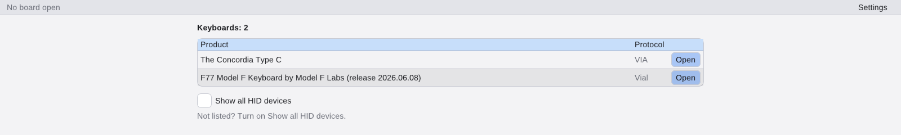

The list shows every keyboard that speaks VIA or Vial, with its protocol, *VIA* or *Vial*,
and an **Open** button. Hover a name to see its maker, its USB id (VID:PID) and its system path.

- **The list follows your keyboards.** Plug one in or unplug it and the list updates within a
  second. There is no Refresh button.
- **A keyboard plugged in later is only listed.** Nazg opens a board by itself only at start,
  and only when it is the only one. Otherwise, click **Open**.
- **A keyboard unplugged while open** closes, and the list says which one went. Changes you had
  not written yet (see "How changes are written") are lost, and the list says so.
- **Not listed?** Turn on **Show all HID devices**. Every other HID interface of the computer is
  then listed under the keyboards, greyed, with its VID:PID, usage page and interface number.
  Those cannot be opened: they are shown so you can check that your keyboard is plugged in and
  what it reports. The setting is off at every start.
- **"no answer"** means the keyboard did not answer VIA's first question. Usually its firmware
  has a raw HID interface but no VIA or Vial behind it. See
  [When something goes wrong](#11-when-something-goes-wrong).

### Allowing a keyboard on Linux

Linux gives a keyboard's configuration interface to the administrator only. Nazg can let your
user configure that one keyboard by adding a *udev rule* for it, a small system file that
Linux remembers:

1. Click **Allow...** on the keyboard's row.
2. The dialog says what will happen. Click **Allow**. Your desktop asks for your password once.
   The password window is your desktop's own, not Nazg's.
3. The keyboard now shows **Allowed** (a shield) beside its **Open** button.

Want to see exactly what runs? **Show the commands** lists them, with **Copy**. You can paste
them into a terminal instead. If your computer has no password window (a minimal window manager,
some containers), the dialog shows the commands to run in a terminal, then **Try again**.

**If the keyboard is still refused** after being allowed, an orange line above the list says
to unplug it and plug it back in. That applies the new rule.

**To undo it**, click **Allowed** and then **Stop allowing**. Nazg deletes the rule file. The
keyboard still types as before. Only Nazg (and VIA or Vial) can no longer configure it. Every
keyboard with the same USB id is affected together, and the dialog says so.

---

## 3. Which definition draws a VIA board

A **Vial** keyboard describes itself, so it just opens.

A **VIA** keyboard needs a *definition*: a `.json` file that says where its keys are and how
they are wired. Nazg looks for one in three places, by the keyboard's USB id:

| Where | What it is |
|---|---|
| **Official** | VIA's whole registry, shipped with Nazg (about 3500 definitions) |
| **Community** | Vendors' own definitions, for boards VIA lacks or has older, shipped with Nazg |
| **Yours** | Files you imported, kept in Nazg's data folder |

- **One match:** the board opens with it.
- **Several matches:** Nazg asks which one draws your board, with each candidate drawn using
  your board's real keymap. The right one shows your keys in sensible places, and a wrong one
  scatters them. Click **Use this one**. Nazg remembers the answer for that keyboard.
- **No match:** Nazg says so and offers **Import a definition...**. Your keyboard's maker or
  designer usually provides the file, often named `via.json`.

The definition only decides how the board is drawn. **Picking one never changes the keymap
stored on the keyboard.**

Later, the board menu has **Change definition...** (choose again) and **Forget choice** (Nazg
asks again next time). Your imported files are listed in **Settings**, under *Definitions*.

Nazg refuses a definition whose USB id is not your keyboard's. A file made for another board
would draw the wrong keys, and writing through it would change the wrong ones.

---

## 4. The board screen

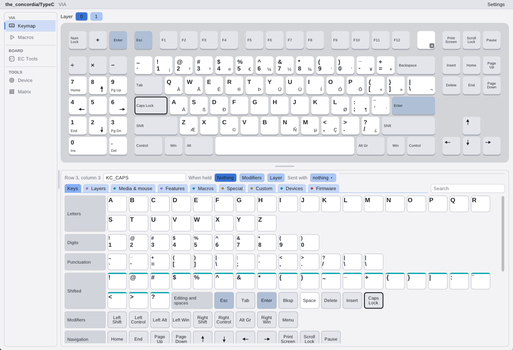

The window is divided into five areas.

**The header**, at the top:

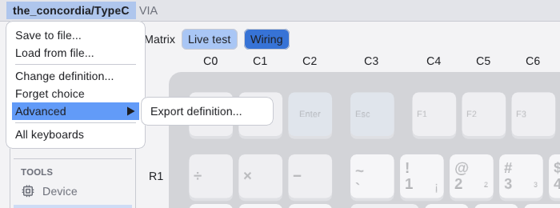

- **The board's name is a menu.** It holds *Switch to* (the other keyboards plugged in),
  *Save to file...* and *Load from file...*, *Change definition...* and *Forget choice* (VIA
  boards), and **All keyboards** (back to the list). With *Advanced tools* on in Settings, it
  also has an *Advanced* submenu.
- The protocol, *VIA* or *Vial*. Hover it to see which definition draws the board, and which
  version of QMK's keycodes it uses.
- **Locked** / **Unlocked**, on Vial boards that have a lock (see "Vial's lock").
- **Settings**.

**The section column**, on the left, lists only what this board has, in up to three groups:

- **VIA** or **Vial**: Nazg's own sections, such as Keymap, Layout, Macros and Lighting.
- **Board**: the board maker's own menus, from its definition.
- **Tools**: Device and Matrix on every board, and Diagnostics on a Leyden Jar controller.

Drag the column's edge to widen or narrow it. Drag it far enough, or double-click the edge, and
it folds to icons only. Hover an icon to see its name.

**The strip**, above the board, is the section's own row of choices: the layers in Keymap, the
slots in Macros (M0, M1...), the groups in QMK Settings. It is absent when the section has
nothing to choose. When the entries do not fit, scroll it with the mouse wheel or the ◀ ▶ at its
ends. A dot on an entry means it has changes not written yet.

**The board**, drawn by Nazg from the definition. What it shows depends on the section.

**The panel**, under the board: the section's editor. Drag the bar between board and panel to
share the height. Nazg remembers it.

### Reading the keys

Keys are drawn as keycaps, with legends for the computer's keyboard layout (set the **Host
layout** in Settings, so a French AZERTY board shows AZERTY).

- **Command keys** (layers, media, macros, lighting...) carry a small coloured header and band
  saying what kind of key they are, such as *Layer*, *Media* or *Boot*. Colours group them at a
  glance, and the words are always there too.
- **A tap-hold key** shows its tap in the middle and its hold at the top right, for example
  *Ctrl* over *A* for `LCTL_T(KC_A)`, or *L1* over a blank for `LT(1, KC_SPC)`.
- **Transparent** keys (`KC_TRNS`, the layer below shows through) are faint, with a **▽** badge
  in a corner. **Empty** keys (`KC_NO`, nothing at all) are faint, with an **✕** badge.
- Hover a key for its full name in QMK's words, and its row and column.

---

## 5. How changes are written

Two ways, depending on the section:

- **Written at once**: Keymap, knobs, Layout, QMK Settings, Lighting, Audio, a board's own menus.
- **Written by Save**: Macros, Tap Dance, Combos, Key Overrides, Alt Repeat Key.

**At once:** each change goes to the keyboard as you make it, then is read back. The panel says
what the board stored. If the board stored something else, or refused, it says so in orange.
**There is no undo.** To go back, change it again, or load a file you saved earlier.

**By Save:** you edit freely, a dot marks each changed slot, and the panel says "Not written
yet". **Save** writes, **Revert** goes back to what the board holds. Unsaved edits are kept
while you move between sections. When you switch boards or quit, Nazg asks: **Save**,
**Discard** or **Cancel**.

Every write is read back, so what Nazg shows is what the keyboard holds, not what Nazg hoped
it would hold.

---

## 6. Vial's lock

Most Vial keyboards are **locked** while plugged in. A locked board refuses a few things:
**macros**, **the matrix test**, **Boot** (`QK_BOOT`) anywhere in the keymap, and **entering
the bootloader**. Everything else is accepted.

To unlock:

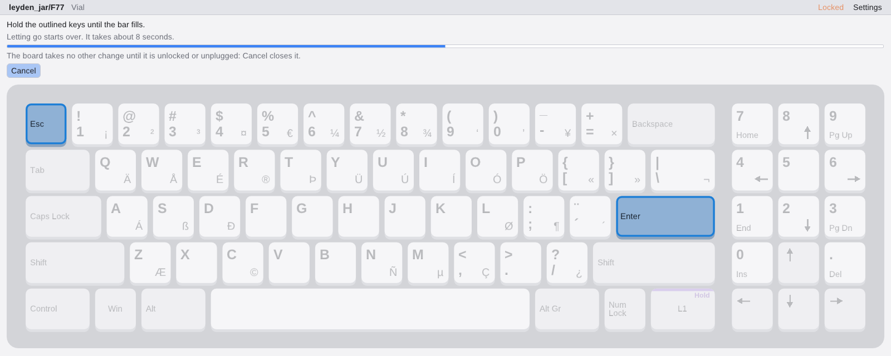

1. Click **Locked** in the header.
2. The keys to hold are outlined on the board, usually two keys chosen by the board's maker.
   Hold them all until the bar fills, a few seconds. Letting go starts the bar over.
3. The header shows **Unlocked**. The board stays unlocked until it is unplugged or you click
   **Unlocked** to lock it again.

While the unlock is waiting, the board answers nothing else, and the firmware cannot be told to
stop waiting. So **Cancel** closes the board, and the list says it is still waiting for its
keys. Unplug it, and it answers again. If you quit while it waits, Nazg closes once the board is
unlocked or unplugged.

A section that needs the unlock says so where it matters, with the unlock keys outlined.

---

## 7. The sections

A board shows only the sections it has. A plain VIA board may show only Keymap, Device and
Matrix. A Vial board with everything turned on may show a dozen.

### Keymap

Change what each key does, on each layer.

1. **Pick a layer** in the strip (0, 1, 2...). Hover a layer to see it on the board without
   choosing it. Its own keys show at full strength, and the keys it leaves transparent are faint.

    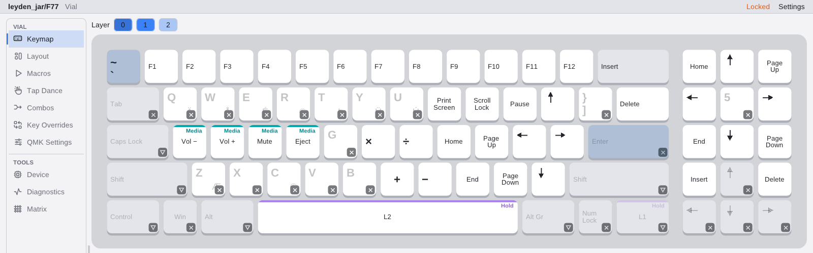

2. **Click a key** on the board. It is outlined.
3. **Click a keycode** in the picker below. It is written at once and read back. The key flashes
   where it landed.

After a pick, the selection stays on the key, so a second click corrects it. To move to the next
key after each pick, as Vial does, turn on **Move to the next key after a pick** in Settings.

**The picker** has tabs, each a kind of key:

- **Basic**: a full-size keyboard, drawn in your host layout (Settings) -- its legends and its
  shape: ISO with its L-shaped Enter for French or German, ANSI for US, JIS for Japanese. Click a
  key to pick it. The key the selected key sends is outlined.
- **Extra**: every other key a keyboard sends -- Transparent (▽) and None (✕) first, then
  *Shifted* symbols (`!`, `@`... in one click), F13-F24, the rarer numpad keys, international
  keys, the rarer HID keys, and the punctuation of the other keyboard shapes. A shifted key shows
  every symbol of its key, as in Basic; its group, or its tooltip (`LSFT(KC_1)`), says it is
  shifted.

    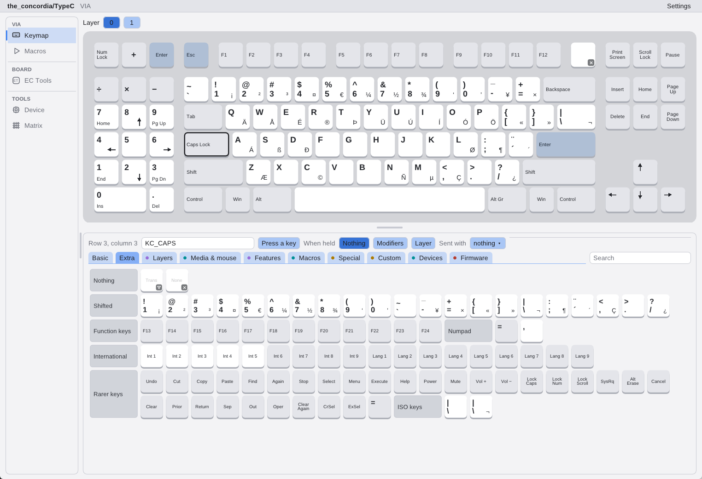

- **Layers**: Hold, Toggle, To, Tap tog, Once, Base, Set base for each layer; one-shot modifiers;
  layer lock, tri layer.
- **Media & mouse**: media, volume, brightness, system and app keys; mouse movement, buttons,
  wheel.
- **Lighting**: only on boards with lighting, the keys that change it.
- **Features**: Caps Word, Repeat, Grave Escape, Leader, Key Lock, Space Cadet, Auto Shift,
  Autocorrect, and the on/off keys of combos, key overrides and others.
- **Macros**: the keys that play a macro (M0...), a tap dance (TD 0...) or a dynamic macro.
- **Special**: settings kept on the board, such as QMK's Magic swaps, NKRO, audio, haptic,
  Unicode mode and Bluetooth output.
- **Custom**: keys the board's own firmware handles, by the names its definition gives them.
- **Devices**: MIDI, steno, joystick, programmable buttons.
- **Firmware**: Boot, Reboot, Clear EEPROM, Debug.

The **search box** looks through every tab, by name, by QMK name (`KC_ESC`) or by label. Hover a
key or a tile to see its QMK name. **While the tooltip shows, the selected key previews what the click
would write**, outlined in blue.

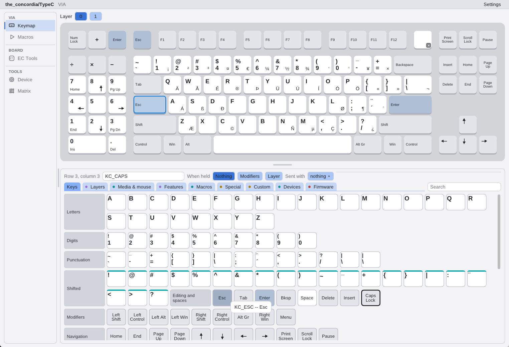

Only what the board can use is offered: no lighting keys on a board without lighting, no more
macro keys than it has macros. Keys the board cannot tell about, such as audio or Unicode, are
offered anyway, and their tooltip says what they need.

**The key line**, above the tabs, shapes the selected key:

- **Where it is**: row and column.
- **Its keycode in QMK's words, editable.** Type anything QMK understands and press Enter:
  `LT(1,KC_SPC)`, `MT(MOD_LCTL,KC_A)`, `C(S(KC_T))`, `OSM(MOD_LSFT)`, `MO(2)`, or a hex value.
  What Nazg cannot read is outlined in red. This is how to enter keys no tab lists.
- **Press a key**: then press a key on the computer's keyboard, and it is written to the selected
  key. Ctrl, Shift, Alt or Win held with it are sent with it (`LCTL(KC_B)`); a modifier pressed
  and let go alone is written itself. Click it again to stop listening. It reads what the computer
  receives: typed on the board being changed, a key sends what it holds now, so a keycode no key
  of the board sends any more is picked in **Basic**, or typed on another keyboard.
- **When held**: *Nothing*, *Modifiers ▾* or *Layer ▾*. This makes the key a tap-hold key: it
  types itself when tapped, and holds a modifier or a layer when held.
- **Sent with ▾**: Ctrl, Shift, Alt, Win (or Cmd, Super...), left or right. This sends the key
  with modifiers, for example Ctrl+C in one key. **None** goes back to the plain key.

The key's hold and modifiers are **kept when you pick another tile** -- but not Shift alone: a
shifted symbol picked over becomes the plain key you pick. With "When held: Layer 1"
set, picking Space writes `LT(1,KC_SPC)` in one step.

**Knobs.** A VIA knob is drawn as a round key, with its press on top and its two turns under
it (↺ and ↻). A Vial knob is drawn as the keys its definition gives, with a ↺ or ↻ badge. Click a
knob: the panel shows **Turn left**, **Turn right** and, on VIA, **Press**. Click one, then
pick its keycode. Each is written at once, on the strip's layer. If the firmware keeps no
*encoder map*, the turns show **?** and cannot be changed: they do what the firmware's code says.

### Layout

The board's layout options, such as split Backspace, ISO Enter or the bottom row. Only on boards
whose definition has them.

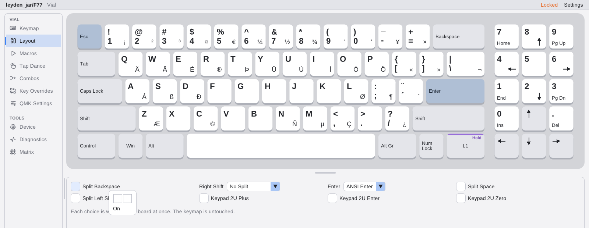

Each option is a checkbox or a drop-down. **Hover a choice to see its drawing.** A choice is
written at once, and the board is then drawn with it. **The keymap is untouched**: a key hidden
by a choice keeps its keycode, and comes back if you choose otherwise.

### Macros

A macro is a key that types a sequence: text, shortcuts, waits.

The strip holds the slots, M0 to the board's last. An empty slot is outlined and unfilled. On the
board, the keys that play the selected macro are marked.

The panel shows the macro as a **chain of steps, left to right**. A long chain wraps onto the
next row. **Click a step** to select it, or click between two steps to place a **+** where the
next one goes. Then:

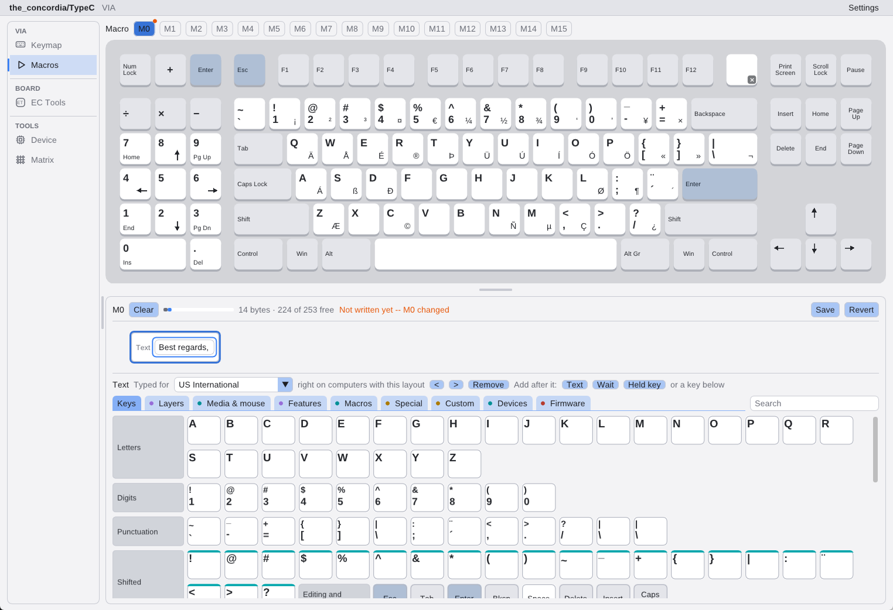


- **Pick a key** in the picker under the chain. It is tapped. **Sent with** makes it a shortcut
  (Win+R) in one step.
- **Add: Text** types text in place. **Wait** pauses, in milliseconds. **Held key** adds a press
  (▼) and a release (▲) with the + between them, so the key stays down while the steps between
  run.
- **Move before**, **Move after** and **Remove** act on the selected step. **Clear** empties the
  whole macro.

**Text is typed the way your computer types it.** Nazg asks for your computer's keyboard layout
the first time a macro holds text (the same **Host layout** as in Settings). It then stores
whatever keystrokes make that layout type your text, accents included where the layout has them
(é, ç, ñ...). Hover a text step to see how each character is typed. A character your layout
cannot type is said. **A text macro types right only on computers set to that layout.** This is
true of every macro, in VIA and Vial too, which assume US English.

The macro's line shows how much of the board's macro memory it takes, shared by all macros.
Hover the macro's name to see it in VIA's script form.

Written by **Save**. On a locked Vial board, macros can be read but not written, and the panel
says how to unlock. Older firmware may have no waits, and VIA macros hold basic keys only. The
panel says so when that applies.

### Tap Dance

*Vial only.* One key doing up to four things, depending on how you press it:

| Action | Gesture |
|---|---|
| **Tap** | pressed and released quickly |
| **Hold** | held past the tapping term |
| **Double tap** | tapped twice quickly |
| **Tap, then hold** | tapped, then pressed again and held |

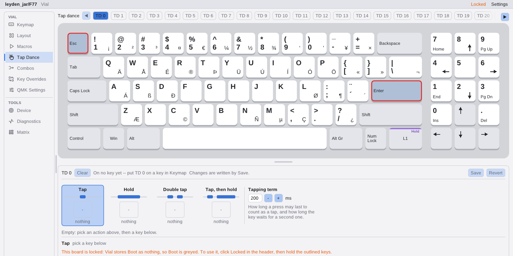

The strip holds the slots, TD 0 and up. The panel shows the four actions side by side, each with
a small timing drawing of its gesture. Click an action, then pick its key. **Empty it** clears
one action. An empty action shows, faint, what the board does instead: no hold means the tap,
held; no double tap means the tap, twice.

The **Tapping term** (milliseconds) separates a tap from a hold, and how long the key waits for a
second tap. A line says when the tap is actually sent. **A dance with a double tap makes its tap
wait** for the term, which can feel late when typing fast.

To use a dance, put its key (TD 0...) on the keyboard in Keymap, from the picker's **Macros** tab.
Keymap then draws the key from its dance, for example as a tap-hold key.

Written by **Save**.

### Combos

*Vial only.* Keys pressed together send another key instead, such as J+K for Esc.

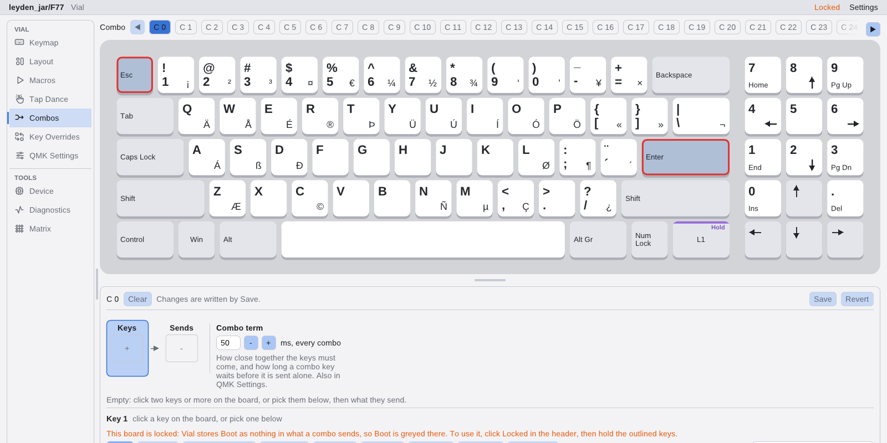

The strip holds the slots, C 0 and up. Build the chord:

- **Click keys on the board** to add them as inputs, and click again to take one out. Or pick
  them in the picker. A combo takes up to four keys.
- Click **Sends**, then pick what the chord sends.

The board lights the selected combo's keys and joins them to a small tag saying what they send.
Under the chord, Nazg says what it does in words, and **what is wrong**, with a fix where there is
one: a key no key of the board sends, two combos with the same keys, one key alone, nothing to
send...

**Good to know:** a combo matches what a key *sends*, not where it is. A key sending
`LCTL_T(KC_A)` is not `KC_A`. Every key in a combo waits briefly before being sent, even when
typed alone, so the board can tell whether the combo is coming. The panel says how long.

The **Combo term** is one value for every combo. It is also shown in QMK Settings. A board
without QMK Settings has a term fixed when its firmware was built, which no app can read.

Written by **Save**.

### Key Overrides

*Vial only.* A key pressed with some modifiers held sends something else. For example, Shift +
Backspace sends Delete.

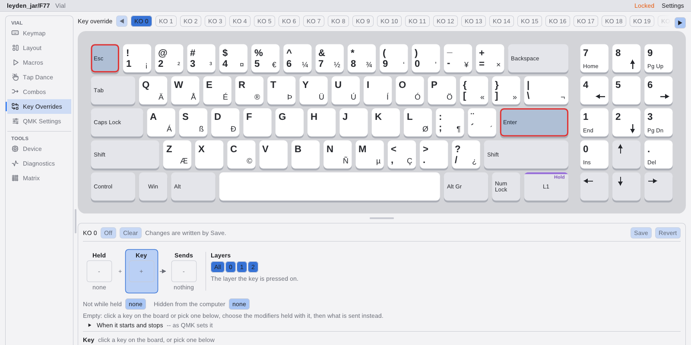

The strip holds the slots, KO 0 and up, with one that is turned off struck through. The panel
shows the rule as **Held + Key → Sends**, with the layers it works on to the right (**All** for
every layer):

- Click **Held**, then choose the modifiers in the tool line: Ctrl, Shift, Alt, Win; **Either
  side / Left / Right**; and, with two or more, **All of them / Any one**.
- Click **Key**, then click a key on the board or pick one.
- Click **Sends**, then pick what is sent. It can only be a plain key with modifiers. The picker
  greys what cannot be sent. Left empty, the combination is simply blocked.
- **Not while held**: modifiers that stop the override.
- **Hidden from the computer**: modifiers the computer does not see while the override acts. It
  follows *Held* by default. **Keep it so**: if Shift is not hidden, Shift + Backspace sends
  Shift + Delete, which deletes permanently in Windows Explorer.
- **On / Off** keeps an override on the board, unused.
- **When it starts and stops** (folded) holds QMK's finer options, in words.

Nazg says in words what the override does, and what is wrong. The first slot that matches wins.
Written by **Save**.

### Alt Repeat Key

*Vial only.* The **Alt Repeat** key (`QK_AREP`) sends a key that goes with the last one typed:
after Ctrl+Z, Ctrl+Y. QMK pairs some keys itself (← and →, Home and End, Backspace and Delete...).
Each entry here adds a pair: **Last key → Alt Repeat sends**.

- Click the arrow to make it **both ways** (⇄): then after what is sent, Alt Repeat sends the
  last key back.
- **May also be held**: other modifiers that may be held with the last key.
- **Left or right alike**: Right Ctrl counts as Ctrl.
- **After any other key too**: this entry answers when no other entry does. QMK's own pairs then
  no longer answer.

For this to do anything, put **Alt Repeat** on a key in Keymap (picker, **Features** tab). The
panel says when no key has it. **A known firmware bug:** vial-qmk sends right-hand modifiers
wrongly here, so use left ones. The panel warns when an entry is affected.

Written by **Save**.

### QMK Settings

*Vial only.* Options QMK normally fixes when the firmware is built, made changeable on the board.
The strip holds the groups the firmware has, from: **Tap-Hold**, **Auto Shift**, **One Shot
Keys**, **Combos**, **Grave Escape**, **Magic**, **Mouse keys**, **Tap delays**.

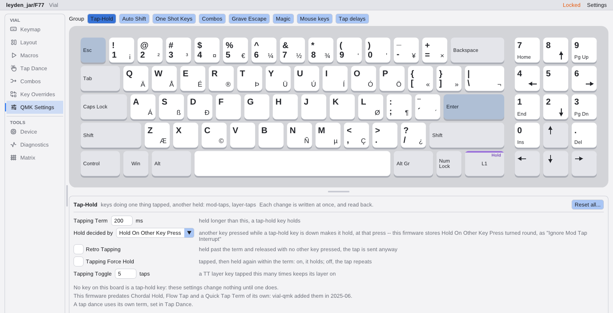

Each line shows QMK's name, with what it does beside it. The board lights the keys a group
concerns, and the keys one line concerns under the pointer. **Chordal Hold**, for example, lights
each key by the hand QMK thinks it belongs to.

**Hold decided by** gathers QMK's tap-hold choices into one choice of three:

- *Tapping Term only*: a tap-hold key holds once the term has passed.
- *Permissive Hold*: another key pressed **and released** while it is down makes it hold.
- *Hold On Other Key Press*: another key **pressed** while it is down makes it hold, at once.

Each change is **written at once** and read back. A number is written when you leave its box or
press Enter. **Reset all...** asks first, then puts every QMK setting back to the firmware's
defaults, Magic and N-key rollover included. Nazg cannot know those defaults before the reset:
they are read back after it.

Keys on the board, such as Magic or Auto Shift keys, can change these settings too. What is shown
is what the board said when the section opened.

### Lighting

The board's backlight, underglow and RGB Matrix, as VIA and Vial know them. Boards with more than
one system show each in the strip.

- **On**, **Effect**, **Speed** (RGB Matrix), **Brightness**, and **Colour** as hue and saturation
  sliders.
- Underglow effects come with their own variant buttons instead of a speed: **Speed** (Slow,
  Medium, Fast, Fastest), **Spread**, **Direction**, **Colours** (One, Random), whichever the
  effect has.
- The backlight has **Brightness** (0 is off) and **Breathing**.

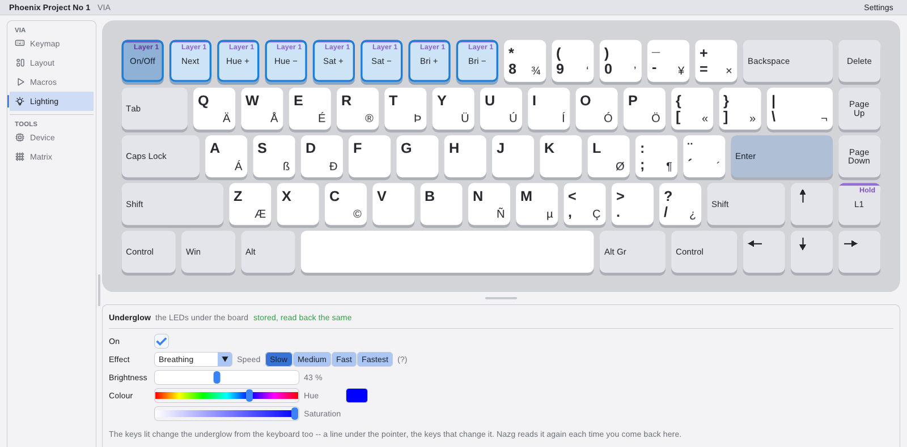

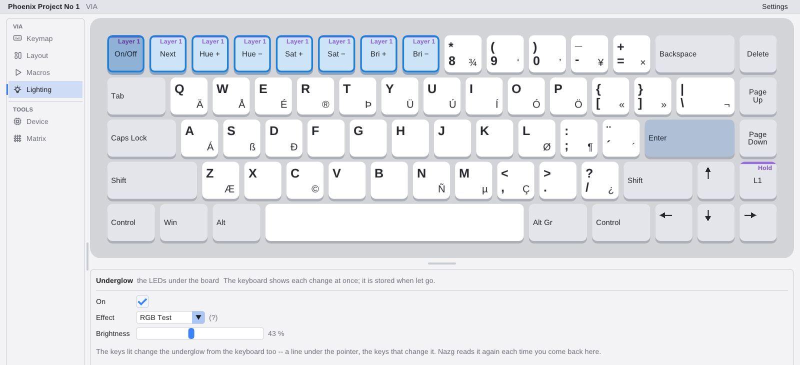

**The keyboard itself is the preview**: a slider changes the lights while it moves, and the value
is stored when you let go. The board lights the keys that change lighting from the keyboard, and
the line under the pointer narrows them.

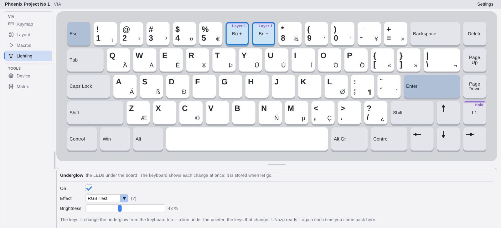

**Effect names can be wrong**: QMK numbers effects among those built into the firmware, so a board
built with fewer effects numbers them differently, and cannot say so. Nazg shows what the board
answers. Some older firmware cannot say whether the underglow is on: the box is then neither
ticked nor unticked until you set it. Nazg reads lighting again each time you come back to the
section, since the keys may have changed it.

A board's own lighting menu, with its maker's effect names, appears under **Board** instead (see
"A board's own menus").

### Audio

*VIA boards whose definition declares audio.* **Audio** turns the board's speaker on or off.
**Clicky** clicks with each key press, heard only with Audio on. **Play a sound** makes the
keyboard play its own song, its lights blinking once. Each change is written at once. A firmware
built without audio is said.

### A board's own menus

Under **Board** in the column: menus the board's maker put in its definition, such as its own
lighting, indicators, or the switch settings of Hall-effect and EC boards. Nazg draws them from the
definition, as VIA does.

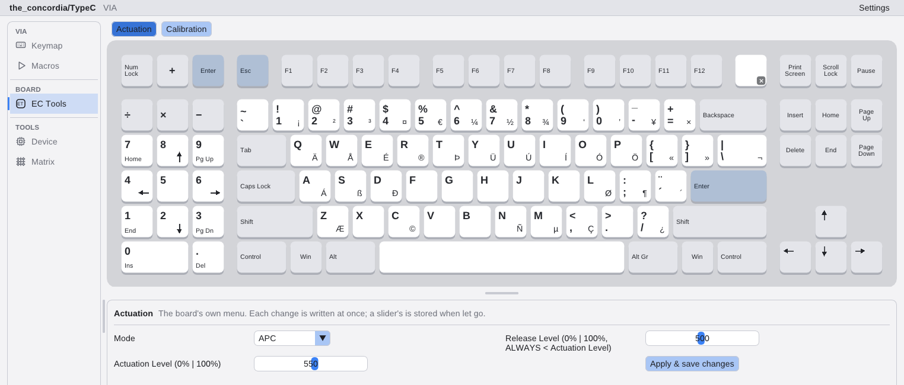

Submenus are in the strip, and lines are in two columns: sliders, drop-downs, checkboxes,
colours, keys (with Keymap's picker) and buttons. **Each change is written at once.** A slider is
stored when let go. Ctrl+click a slider to type a value. Some sliders are tied together by the
board: moving one moves the other, and the panel says so.

**A button runs at once, without asking**, as in VIA. Its label is the maker's own warning, for
example "Factory reset (erases all settings and restarts)", so read it before clicking.

### Device

On every board, in **Tools**:

- **Enter bootloader...**: the keyboard restarts in its bootloader, ready for new firmware. It
  leaves Nazg, and comes back in the list once flashed. VIA has no command for this, and neither
  has a Vial firmware built insecure. The section then says how instead: the lit key holding
  `QK_BOOT`, the board's reset button, or putting `QK_BOOT` on a key in Keymap. On a locked Vial
  board, unlock first.
- **Reset keymap...**: every layer's keys and knobs go back to the keymap the firmware was built
  with. Macros, lighting, layout options and Vial's features stay.
- **Empty macros...**: every macro is emptied. Keys that play one stay, and play nothing.

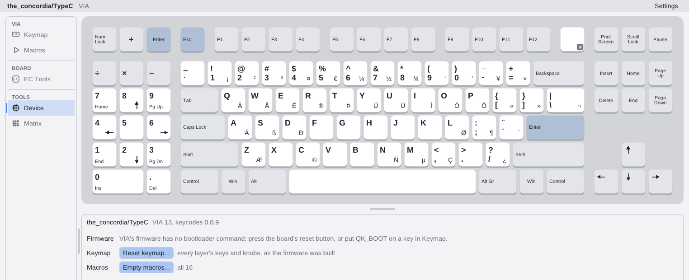

Each asks first. **To keep what the board holds, use Save to file... before.** Load from file...
brings it back.

### Matrix

On every board, in **Tools**: the board's wiring and a key test. The strip has **Live test** and
**Wiring**.

**Live test** starts as soon as the section shows. **Press every key once**: each turns green when
seen, with a count. A row or column label turns green once all its keys are seen. One that stays
grey points at that trace. A key lighting without being pressed points at ghosting, or a missing
diode. **Start over** clears it.

**What is tested is your choice**, at the strip's end: **Computer's keys** or **Switches**. The
panel's first line always says which. Each test keeps what it has seen, so you can go from one to
the other and back.

- **Computer's keys**, chosen from the start on every board, tests what the computer receives --
  the keymap and the system as much as the switches, which is what most check after programming a
  board. **Hatched** keys send nothing the computer hears (layer keys, empty keys, Boot, macros)
  and cannot be tested this way. Keys sending the same thing light together, marked **?**. While
  this test runs, Nazg takes the whole keyboard, so Win and Alt+Tab are tested rather than acted on.

    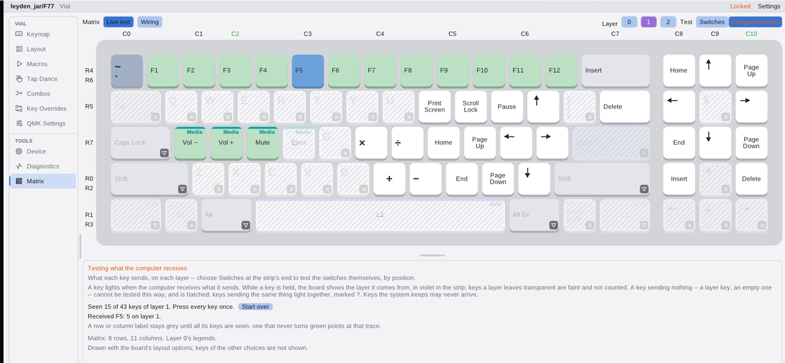

    **The layers are in the strip**, as in Keymap: the board draws the layer you choose, and the
    keys it leaves transparent are faint with ▽ and not counted. The computer cannot tell which
    layer is on, so a key received counts on every layer whose own key sends it -- the layer shown
    is a view, the count is per layer. The panel says what arrived and where ("Received F1: 1 on
    layer 1"), or, when the layer shown has no such key, which layer has it, with a **Show layer n**
    button. **While a key is held, the board shows the layer that key comes from**, its tab violet;
    released, the strip's layer comes back at once. So Fn and 1 light F1 on layer 1 with no layer to
    pick yourself.

- **Switches** asks the board which switches are pressed, whatever they send: the better test for a
  board just soldered -- by position, whatever the keymap, ghosting and rollover included. It tests
  positions, so the strip has no layers there.

    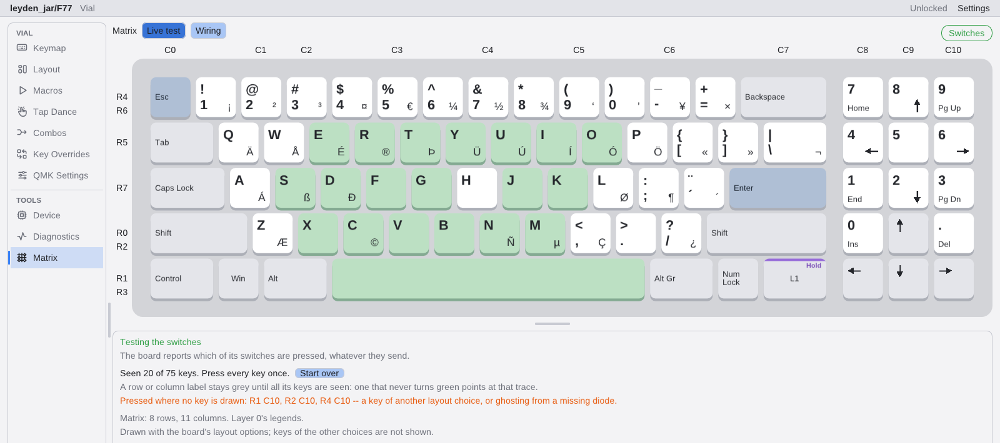

    Most VIA firmware refuses to report its switches, for safety, and a locked Vial board refuses
    until it is unlocked. Where it is refused the test falls back to the computer's keys and says
    why -- on a locked Vial board, click **Locked** in the header. Switches is greyed out once the
    board is known not to report them.

While either test runs, the board types into Nazg, so keyboard navigation is off.

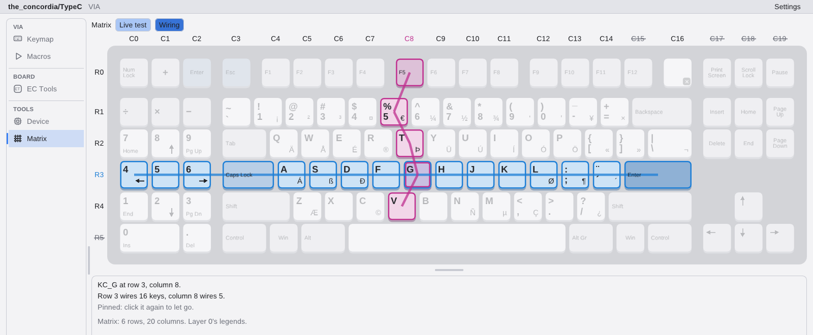

**Wiring**: hover a key and its row and column light, on the board and in the rulers. Click to
pin. With a row selected, columns with no key in it are struck through. The panel says what the
definition tells about the matrix: keys wired in parallel, a key drawn twice, a key outside the
matrix.

### Diagnostics

*Only on keyboards with a Leyden Jar controller* (Model F and Beam Spring replacements). Opening
it turns the keyboard's typing off, and it comes back on when you leave. The strip has:

- **Key presses**: what is pressed now, and every key seen pressed, from the board, QMK's matrix
  or the controller.
- **Signal levels**: each key's readings against its threshold, and Nazg's verdict on the keys at
  risk: keys that may type by themselves, or may miss presses. Click a key for its levels and last
  presses.

    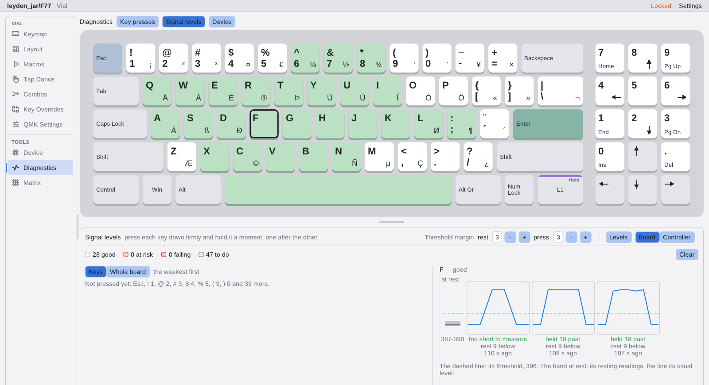

- **Device**: the controller's information, **Enter bootloader**, and **Erase EEPROM**, which puts
  every layer, macro, tap dance, combo, override and setting back to the firmware's own. Erase asks
  first. It cannot be undone.

---

## 8. Saving a board to a file

In the board menu (click the board's name):

**Save to file...** writes what the keyboard holds to a Vial `.vil` file: keymap, knobs, layout
options, macros, and on Vial boards, tap dances, combos, key overrides, alt repeat keys and QMK
settings. It works for VIA boards too. Vial can open Nazg's files, and Nazg opens Vial's.
Lighting, audio and a board's own menus are not in a `.vil` file.

**Load from file...** reads a `.vil` file, or a `.json` saved by the VIA app, and **shows what would
change before writing anything**:

- The board is drawn as it would be, with **the changed keys lit** and a dot on each layer that
  changes. The panel lists each part (Keymap, Layout, Knobs, Macros...) as *the same* or what
  changes. Hover a line to light its keys.
- What does not fit the board is left out and said: another matrix size, more layers or slots
  than the board has, settings its firmware lacks.
- **A file from another keyboard** is asked about first: **Load anyway** or **Cancel**.
- **Apply** writes only what differs, each value read back. On a locked Vial board that needs it
  (macros, Boot), the button reads **Unlock and apply**, and the unlock comes first.
- Once written, the screen says "Written and read back", with what failed if anything did. A
  change the board did not keep stays marked. **Back to the board** returns to the board, read
  again.

A file saved by VIA holds the keymap, knobs and macros only, and the review says so.

---

## 9. Settings

Click **Settings** in the header. **Back to the board** (or *Back to the keyboards*) returns.

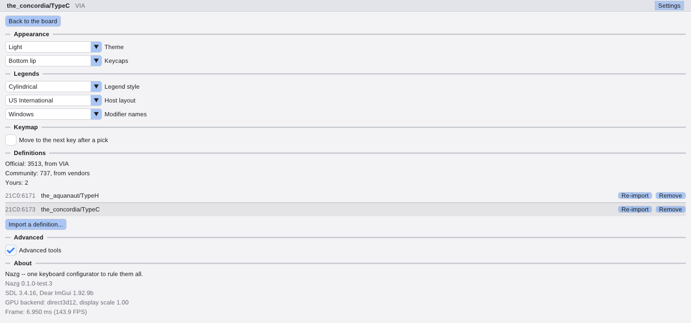

**Appearance**

- **Theme**: Light, Dark or Dracula.
- **Keycaps**: *Outlined* (a thin border) or *Bottom lip* (a darker strip under each key).

**Legends**

- **Legend style**: *Cylindrical* (top left, mixed case, like GMK keycaps) or *Spherical*
  (centred capitals, like SA keycaps).
- **Host layout**: the layout your computer types with, out of 69. Legends show what each key
  types there, and macro text is typed for it. **It does not change the keyboard.**
- **Modifier names**: Windows (Win, Alt), Mac (Cmd, Option) or Linux (Super).

**Keymap**

- **Move to the next key after a pick**, off by default. With it on, each pick moves the
  selection to the next key, top to bottom then left to right. Remember that every pick is written
  at once, with no undo.

**Definitions**

- How many official and community definitions this Nazg carries. Hover them for their version.
- **Yours**: the definitions you imported, each with **Re-import** (read the file again after
  editing it, keeping the old version), **Restore previous** and **Remove**.
- **Import a definition...**

**Advanced**

- **Advanced tools**, off by default, for keyboard designers and debugging. It adds an *Advanced*
  submenu to the board menu, with **Export definition...** (the definition drawing the board,
  exactly as Nazg has it), and every lighting key to the picker.

**About**: Nazg's version, and its definitions' versions. Please include them when reporting a
problem.

Settings are saved by themselves, a second after each change and when Nazg closes.

---

## 10. Where Nazg keeps its files

| | Folder |
|---|---|
| Windows | `%APPDATA%\mymakercorner\Nazg\` |
| Linux | `~/.local/share/mymakercorner/Nazg/` |
| macOS | `~/Library/Application Support/mymakercorner/Nazg/` |

It holds `settings.json` and the definitions you imported. Deleting the folder resets Nazg. Your
keyboards keep their configuration either way. Hover **Yours** in Settings to see the exact path.

On Linux, the rules Nazg writes to allow a keyboard are system files in `/etc/udev/rules.d/`, one
per keyboard. Use **Stop allowing** to remove one.

---

## 11. When something goes wrong

**My keyboard is not in the list.**
Turn on *Show all HID devices* and look for it there. If it is listed there but not as a
keyboard, its firmware was built without VIA or Vial (`VIA_ENABLE`). Nazg cannot configure it:
flash a firmware with VIA or Vial.

**It says "no answer".**
The keyboard did not answer VIA's question. Unplug it and plug it back in. A board still waiting
for its Vial unlock answers nothing until it is unplugged.

**It says "not allowed" (Linux).**
Click **Allow...** (see "Allowing a keyboard on Linux").

**A VIA board opens with "no definition".**
Ask its maker for its `via.json` and use **Import a definition...**. If several definitions match
and the board looks wrong, choose again with **Change definition...** in the board menu.

**A key I set does not stick, or shows something else.**
The panel says what the board stored. A locked Vial board stores Boot as nothing: unlock it first.
A keycode the firmware does not know is refused.

**Nothing lights in the key test.**
Look at the choice at the strip's end. On *Computer's keys*, hatched keys cannot be tested that way,
and a key on another layer counts on the layer that sends it -- hold it and the board follows.
On a locked Vial board, click **Locked** first.

**My macro types the wrong characters.**
Check **Host layout** in Settings: macro text is typed for that layout, on computers set to it.

**The lighting effect is not the one I chose.**
The firmware was built with fewer effects than VIA's list assumes, so its numbers differ. If the
board has its own lighting menu under **Board**, use that one: it has the maker's own list.

**Nazg closed my board.**
The board was unplugged or restarted (after a bootloader, an EEPROM erase or a reset). It comes
back in the list. Open it again.

---

## 12. Reporting a problem

Problems and ideas: <https://github.com/mymakercorner/nazg/issues>

Please say:

- which keyboard, and whether it runs VIA or Vial (the header shows it),
- what you did, and what you saw,
- Nazg's version and its definitions' versions (Settings, *About* and *Definitions*),
- your system: Windows, macOS, or Linux with its distribution and desktop.

A screenshot helps. A `.vil` file from **Save to file...** helps with anything about the keymap or
the features.

---

Nazg is free software under the GNU General Public License, version 3 or later. Its source is at
<https://github.com/mymakercorner/nazg>.
